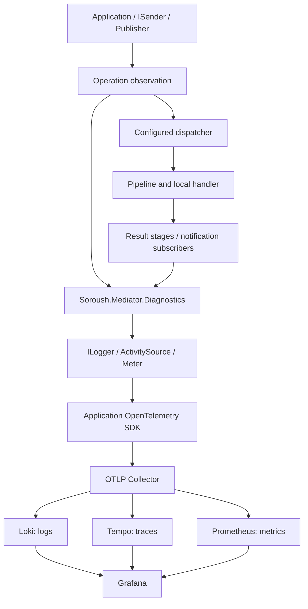

**طرح مشاهده‌پذیری Mediator در Soroush**

تاریخ: ۲۰۲۶/۱۱/۱۲
وضعیت: پیاده‌سازی کتابخانه و پیکربندی نمونهٔ استقرار؛ راهنمای اجرا در [mediator diagnostics](mediator-diagnostics.md)
دامنه: Request، Command، Query، Stream، Notification و مراحل هندلرهای Result

Soroush برای هر اجرای Mediator یک context مشترک می‌سازد و لاگ، trace و metric را به همان اجرا وصل می‌کند. بستهٔ تشخیصی اختیاری است. رفتار درخواست، ترتیب pipeline، lifetime سرویس‌ها، خطاها و cancellation باید قرارداد فعلی را حفظ کنند. قراردادهای اجرایی و روش راه‌اندازی در راهنمای Diagnostics مستند شده‌اند. استقرار production به تنظیمات محیط مصرف‌کننده تعلق دارد.

**۱. تصمیم‌های معماری**

| موضوع | تصمیم |
| --- | --- |
| لاگ | `Microsoft.Extensions.Logging.ILogger` با template و EventId پایدار |
| Trace | `ActivitySource` با نام `Soroush.Mediator` |
| Metric | `Meter` با نام `Soroush.Mediator` |
| ارسال | OpenTelemetry SDK و OTLP در برنامهٔ مصرف‌کننده |
| جمع‌آوری | OpenTelemetry Collector با سه pipeline مستقل |
| ذخیره و نمایش مرجع | Loki برای لاگ، Tempo برای trace، Prometheus برای metric و Grafana برای مشاهده |
| مرز اجرای درخواست | `Mediator` در ورودی `ISender` |
| مرز انتشار | `NotificationPublisher` در ورودی `INotificationPublisher` |
| جزئیات داخلی | observer برای هندلر، مرحله و Subscriber |
| حالت بدون افزونه | observer بدون عملیات و حفظ مسیر فعلی |
| خطای telemetry | اختلال در telemetry نباید نتیجه یا exception درخواست را عوض کند |

انتخاب `ILogger` و logging بدون عملیات با [راهنمای کتابخانه‌های .NET](https://learn.microsoft.com/en-us/dotnet/core/extensions/logging/library-guidance) سازگار است. کتابخانه از APIهای استاندارد trace و metric استفاده می‌کند؛ ساخت SDK، انتخاب exporter، Resource و backend به برنامهٔ مصرف‌کننده تعلق دارد. این جداسازی با [راهنمای instrumentation در .NET](https://learn.microsoft.com/en-us/dotnet/core/diagnostics/distributed-tracing-instrumentation-walkthroughs) هم‌راستاست.



**۲. تقسیم کد بین بسته‌ها**

| بسته | مسئولیت |
| --- | --- |
| `Soroush.Mediator.Abstractions` | قرارداد observer، metadata، outcome و context محدود به جریان async؛ hookهای مراحل در بیس‌هندلرها |
| `Soroush.Mediator` | شروع و پایان operation، اتصال به dispatcher، اندازه‌گیری چرخهٔ Stream و ثبت metadata هندلرها و Subscriberها |
| بستهٔ جدید `Soroush.Mediator.Diagnostics` | تبدیل رویدادهای observer به `ILogger`، Activity و Meter؛ تنظیمات و افزونهٔ DI |
| برنامهٔ مصرف‌کننده | SDK و exporter، هویت سرویس، OTLP endpoint، credentials و shutdown |
| پیکربندی عملیاتی مستقل | Collector، backendها، داشبورد، alert و retention |

بستهٔ Abstractions وابستگی به ILogger، SDK یا backend نمی‌گیرد. بستهٔ Diagnostics هم SDK یا اتصال شبکه نمی‌سازد. هر دو target فعلی `netstandard2.0` و `net8.0` حفظ می‌شوند؛ APIهای DiagnosticSource در target استاندارد از بستهٔ سازگار تأمین می‌شوند و نسخه‌ها در `Directory.Packages.props` مدیریت می‌شوند. سازگاری هر دو asset باید در build و pack بررسی شود.

**۳. قرارداد مشاهدهٔ اجرا**

قرارداد پیشنهادی شامل این نقش‌هاست:

- `IMediatorObserver.StartOperation`: دریافت metadata و ساخت observation مستقل برای یک اجرا.
- `IMediatorOperationObservation.Activate`: فعال کردن context و Activity و برگرداندن یک lease برای بازگرداندن context قبلی.
- `StartStage`: ساخت observation برای یک مرحله یا Subscriber.
- `Complete`: ثبت outcome نهایی، زمان، کد نتیجه و اطلاعات exception.
- `Dispose`: آزادسازی منابع observation؛ مجوزِ اعلام موفقیت ضمنی ندارد.

observer فقط metadata و در صورت نیاز خود exception را دریافت می‌کند. request، response، query filter و مقادیر DTO به observer عمومی تحویل داده نمی‌شوند. classifier سفارشی می‌تواند خروجی را در محل طبقه‌بندی کند، اما خروجیِ classifier فقط metadata محدود است.

observer می‌تواند singleton و بدون state متعلق به درخواست باشد؛ context، stopwatch و outcome داخل observation مستقل نگهداری می‌شوند. context در `AsyncLocal` به‌صورت stack از scopeهای مستقل حمل می‌شود و هر lease مقدار قبلی را در `finally` برمی‌گرداند. درخواست تودرتو operation جدید با parent خودش می‌سازد.

مرحله‌ها از context جاری استفاده می‌کنند، بنابراین هندلرهای موجود برای دریافت logger به constructor جدید نیاز ندارند. فراخوانی مستقیم `handler.Handle` خارج از Sender به‌طور پیش‌فرض context ندارد؛ برای آن مسیر، helper صریح `MediatorObservation.BeginOperation` در قراردادهای Abstractions عرضه شده است.

**۴. مرز پوشش و سازگاری DI**

همهٔ overloadهای `Send` و `CreateStream` در Mediator پوشش داده می‌شوند. observer دورِ فراخوانی dispatcher قرار می‌گیرد؛ بنابراین نتیجه و خطای آداپتور جایگزین نیز قابل مشاهده است. مسیرهای void و Stream به وجود `IPipelineBehavior` وابسته نمی‌شوند.

`LocalRequestDispatcher` فقط metadata هندلرِ واقعاً انتخاب‌شده را به operation جاری اضافه می‌کند. در short circuit یک behavior، نام هندلر اجراشده خالی است. ترتیب behaviorها و امکان جایگزینی cancellation token توسط behavior حفظ می‌شود.

`NotificationPublisher` مالک operation انتشار است. `LocalNotificationDispatcher` برای هر Subscriber واقعاً اجراشده یک observation فرزند می‌سازد. `LocalNotificationPublisher` نیز باید از همین مرز مشترک انتشار استفاده کند. ترتیب ترتیبی Subscriberها، توقف روی اولین exception و موفقیت در نبود Subscriber حفظ می‌شود.

ثبت سرویس‌ها با factory صریح انجام می‌شود تا constructor مناسب همراه observer انتخاب شود و constructorهای عمومی فعلی همچنان قابل استفاده باشند. `IRequestDispatcher` و `INotificationDispatcher` همان instance محلی یا سفارشی باقی می‌مانند؛ بنابراین قرارداد `UseRequestDispatcher` و `UseNotificationDispatcher` و انتظار تست‌های فعلی دربارهٔ نوع dispatcher حفظ می‌شود.

factory بستهٔ Diagnostics در نبود ILoggerFactory از NullLoggerFactory استفاده می‌کند. نبود logging provider یا SDK نباید resolution سرویس را خراب کند. options در startup اعتبارسنجی می‌شوند؛ خطای روشنِ پیکربندی هنگام راه‌اندازی با خطای telemetry در زمان اجرای درخواست تفاوت دارد.

`AddSoroushDiagnostics` فقط observer و options را ثبت می‌کند؛ جایگزینی و تزئین مجدد dispatcher انجام نمی‌دهد. اجرای چندبارهٔ آن باید idempotent باشد و ترتیبش نسبت به AddMediator و UseDispatcher نتیجه را عوض نکند. ثبت دستی `ISender` یا Publisher سفارشی که مرز مشترک را دور بزند، به wrapper صریح نیاز دارد. فراخوانی مستقیم dispatcher نیز فقط با wrapper صریح پوشش operation می‌گیرد.

**۵. مدل نتیجه**

Outcome مربوط به مشاهده‌پذیری مستقل از enum فعلی `HandlerResultCode` است؛ مقدارهایی مثل cancellation به قرارداد نتیجهٔ کسب‌وکار اضافه نمی‌شوند.

| اتفاق | Outcome | سطح رویداد نهایی | وضعیت span به‌صورت پیش‌فرض |
| --- | --- | --- | --- |
| پاسخ عادی یا Result موفق | `succeeded` | Information | Unset |
| Failure از HasAccess یا Validate | `rejected` | Information | Error |
| Failure از Execute یا PreProcess | `failed` | Warning قابل تنظیم | Error |
| لغو با token مرتبط و لغوشده | `cancelled` | Debug | Unset |
| Dispose پیش از پایان Stream | `abandoned` | Debug | Unset |
| exception غیرمنتظره | `faulted` | Error | Error |
| شکست PostProcess | `faulted` و مرحلهٔ PostProcess | Error | Error |

`Failure` بازگشتی حتی بدون exception شناسایی می‌شود. default classifier از کلاس پایهٔ مشترک `HandlerResult` استفاده می‌کند، بنابراین نوع generic و نوع بدون مقدار هر دو پوشش دارند. پاسخ‌های دیگر، مگر با classifier سفارشی، موفق تلقی می‌شوند.

`rejected` به معنی ناموفق بودن این عملیات است و به‌صورت پیش‌فرض span خطا دارد؛ این به معنی خرابی زیرساخت یا الزام ثبت Error log نیست. برنامه می‌تواند نتیجهٔ منفیِ مورد انتظارِ یک query را با classifier به outcome موفق و span بدون خطا نگاشت کند. SLO فنی نیز rejection را با exception یکسان حساب نمی‌کند.

`OperationCanceledException` فقط وقتی cancellation محسوب می‌شود که token مرتبط با operation یا مرحله، از جمله token جایگزین/linked، واقعاً لغو شده باشد. exception نامرتبطِ cancellation به‌طور خودکار پنهان نمی‌شود. همان exception و token به فراخواننده منتقل می‌شوند.

در failure یک `error.type` محدود و پایدار، مانند `soroush.mediator.validation` یا نام canonical نوع exception، استفاده می‌شود. در موفقیت error.type وجود ندارد. این سیاست از [راهنمای ثبت خطا در OpenTelemetry](https://opentelemetry.io/docs/specs/semconv/general/recording-errors/) استفاده می‌کند؛ این راهنمای عمومی در زمان طراحی وضعیت Development دارد و schema اختصاصی Soroush باید جداگانه version شود.

**۶. رویدادها و مالکیت لاگ**

| EventId | نام پایدار | رفتار |
| --- | --- | --- |
| 1000 | `soroush.mediator.operation.started` | Debug |
| 1001 | `soroush.mediator.operation.completed` | یک رویداد نهایی با سطح مطابق outcome |
| 1100 | `soroush.mediator.stage.started` | Trace |
| 1101 | `soroush.mediator.stage.completed` | Debug؛ نتیجهٔ شکست هم در metadata ثبت می‌شود |
| 1900 | `soroush.mediator.exception` | جزئیات exception فقط در مرز مالک |
| 1990 | `soroush.mediator.diagnostics.failure` | self-diagnostic محدود، خارج از مسیر observer |

یک اجرا باید دقیقاً یک بار برای emission رویداد completed اقدام کند. مرحله‌ای که اجرا نشده رویداد شروع یا پایان نمی‌گیرد. این تضمین محلی است؛ تحویل به Collector یا backend ممکن است با drop یا retry همراه باشد و تحویل exactly once تضمین نمی‌شود.

رویداد نهایی شامل `OperationId`، `ParentOperationId`، `RequestName`، `Kind`، `HandlerName` در صورت وجود، `Outcome`، `Stage` در صورت شکست، `ResultCode`، `DurationMs` و برای Stream تعداد آیتم‌هاست. OperationId حتی بدون listenerِ tracing قابل استفاده است. شناسه‌های معتبر trace و span از Activity جاری به state ساختاریافتهٔ همان رکورد و خروجی OTLP منتقل می‌شوند.

`Result.Message` و متن exception به‌صورت پیش‌فرض در summary کپی نمی‌شوند. متن آزاد ممکن است شامل دادهٔ درخواست باشد؛ ثبت آن‌ها به policy و redactor برنامه وابسته است. EventId، template و نام فیلدها قرارداد نسخه‌دارند و مقادیر پویا با string interpolation وارد template نمی‌شوند.

پیاده‌سازی adapter از `LoggerMessage` یا delegateهای ازپیش‌ساخته استفاده می‌کند و محاسبات پرهزینه را با `IsEnabled` محافظت می‌کند؛ این انتخاب با [راهنمای کارایی logging کتابخانه‌ها](https://learn.microsoft.com/en-us/dotnet/core/extensions/logging/library-guidance) سازگار است.

**۷. exception، خطای cleanup و جلوگیری از تکرار**

`ExceptionDetailsOwner` دو حالت دارد:

- `ApplicationBoundary`، پیش‌فرض: Mediator نتیجه و مرحله را ثبت می‌کند؛ middleware یا مرز Worker جزئیات کامل exception را ثبت می‌کند.
- `OutermostMediator`: بیرونی‌ترین operation در زنجیرهٔ Mediator جزئیات خطای خروجی را یک بار ثبت می‌کند. برای Worker یا استفاده‌ای که logger سراسری خطا ندارد مناسب است.

مرحله‌ها و operationهای تودرتو همان exception را دوباره با stack trace لاگ نمی‌کنند. اطلاعات مرحله روی observation ذخیره می‌شود و ریشهٔ مربوط آن را در رویداد جزئیات استفاده می‌کند. اگر یک خطای فرزند در منطق برنامه مدیریت شود، به‌صورت خودکار exception کاملِ خروجی در مرز ریشه ندارد؛ summary فرزند همچنان نتیجهٔ همان اجرای فرزند را نشان می‌دهد.

در Stream، هم‌زمانی خطای Execute و PostProcess باید اطلاعات هر دو را حفظ کند. تغییر پیشنهادیِ سازگار، افزودن property خواندنی `PrimaryException` و overload جدید constructor به `HandlerStageException` است؛ `Code=PostProcess` و قرارداد فعلی `InnerException` مربوط به cleanup حفظ می‌شوند. اگر شکست اولیه یک Result بوده، context کد و مرحلهٔ آن را هم حفظ می‌کند.

در حالت ApplicationBoundary، serializer خطای میزبان باید PrimaryException را نیز ثبت کند. در حالت OutermostMediator، adapter هر علت متمایز را یک بار با همان OperationId و نقش `primary` یا `cleanup` ثبت می‌کند. خروجیِ exception فعلی با AggregateException جایگزین نمی‌شود. exception و مسیر معمول cancellation با `throw;` یا مکانیزمی که stack اصلی را حفظ می‌کند ادامه پیدا می‌کنند.

خطای observer، logger، listener یا redactor به مسیر کسب‌وکار نشت نمی‌کند. محافظ‌های کوچک فقط دور عملیات telemetry قرار می‌گیرند؛ catch عمومی نباید خطای خود هندلر را بخورد. گزارش خطای telemetry از مسیر self-diagnostic با محدودیت نرخ انجام می‌شود تا logging بازگشتی ایجاد نشود. این رفتار مطابق [اصول error handling در OpenTelemetry](https://opentelemetry.io/docs/specs/otel/error-handling/) است.

**۸. چرخهٔ عمر Stream**

Stream یک operation مستقل برای هر enumeration دارد. ساخت enumerable به‌تنهایی operation موفق ایجاد نمی‌کند. اعتبارسنجی sync فعلی CreateStream حفظ می‌شود؛ ورودی نامعتبر قبل از آغاز enumeration خطای استفاده از API است.

در مسیر معمول، operation با اولین MoveNextAsync آغاز می‌شود و تا پایان واقعی یا Dispose ادامه دارد. آداپتوری که در خود CreateStream یا GetAsyncEnumerator خطای sync بدهد، یک اجرای faulted با phase برابر stream_create یا enumerator_create ثبت می‌کند و همان خطا با همان زمان‌بندی قبلی منتقل می‌شود. فراخوانی‌های producer برای ساخت چنین لاگی به زمان دیگری منتقل نمی‌شوند.

1. scope در زمان GetAsyncEnumerator آماده می‌شود و اگر هرگز خواندن شروع نشود، هیچ اجرای مصنوعی ثبت نمی‌شود.
2. دورِ هر MoveNextAsync و DisposeAsync، context و Activity همان enumeration فعال و سپس context مصرف‌کننده بازگردانده می‌شود.
3. Result ناموفقِ آیتم، outcome شکست را تعیین می‌کند؛ پایان بعدی enumeration آن را به success تبدیل نمی‌کند.
4. پایان طبیعی، لغو مرتبط، خطای producer و توقف زودهنگام هرکدام outcome مستقل دارند.
5. Complete پس از پایان cleanup انجام می‌شود؛ شکست Dispose نیز در نتیجهٔ نهایی دیده می‌شود.
6. Dispose تکراری رویداد نهایی اضافی نمی‌سازد. لغو از پارامتر CreateStream و token مصرف‌کننده هر دو حفظ می‌شوند.

شکست مشاهده‌شده با توقف زودهنگام بعدی به abandoned تبدیل نمی‌شود. خطای cleanup بر outcome نهایی faulted اولویت دارد و اطلاعات failure یا exception قبلی را کنار خودش حفظ می‌کند.

Activity و context نباید در فاصلهٔ بین دو آیتم به کد مصرف‌کننده نشت کنند. metadata لاگ در state هر رکورد snapshot می‌شود تا scopeهای تودرتو کلید تکراری یا مقدار قدیمی نسازند؛ scopeهای سفارشیِ میزبان همچنان قابل استفاده‌اند. wrapper پیشنهادی `ObservedAsyncEnumerator<T>` فعال‌سازی را برای هر فراخوانی کنترل می‌کند. برای دو enumeration درهم‌تنیده، state و parent هرکدام مستقل است.

`DurationMs` کل عمر enumeration را، شامل توقف مصرف‌کننده بین آیتم‌ها، نشان می‌دهد. `ProducerDurationMs` مجموع زمان سپری‌شده داخل MoveNextAsync و DisposeAsync است و مکث مصرف‌کننده بین فراخوانی‌ها را شامل نمی‌شود. این مقدار زمان wall داخل producer است و معادل CPU time نیست. اگر مصرف‌کننده بیرون MoveNext خطا بدهد، wrapper فقط Dispose زودهنگام را می‌بیند و آن را خطای producer اعلام نمی‌کند.

PostProcess بعد از موفقیت دسترسی طبق قرارداد فعلی با CancellationToken.None انجام می‌شود. هیچ timeout عمومیِ cleanup یا retry مخفی توسط diagnostics اضافه نمی‌شود. مصرف‌کننده باید enumerator را Dispose کند؛ رها کردن آن بدون Dispose، پایان و cleanup قابل تضمین ندارد و finalizer هم راهکار ثبت پایان نیست.

**۹. ساختار trace**

نام ActivitySource و Meter هر دو `Soroush.Mediator` است و نسخهٔ کتابخانه به instrumentation scope افزوده می‌شود. operation محلی ActivityKind.Internal دارد؛ آداپتور transport خودش span شبکه یا پیام را مطابق قرارداد همان transport می‌سازد.

نام span از نوع ثابت request ساخته می‌شود، برای مثال `mediator.send CreateOrder`. نوع کامل request در attribute ثبت می‌شود؛ شناسهٔ سفارش یا ورودی کاربر وارد نام span نمی‌شود. parent از Activity معتبر جاری گرفته می‌شود و request تودرتو parent جدید خودش را دارد.

مراحل HasAccess، Validate، PreProcess، Execute و PostProcess در حالت جزئیات، span فرزند دارند. هر Subscriber نیز span فرزند انتشار خودش دارد. تولید یک span برای هر آیتم Stream پیش‌فرض نیست. زمان span اجرای Stream می‌تواند شامل وقفه‌های مصرف‌کننده باشد؛ ProducerDuration جداست.

کلیدهای اختصاصی با پیشوند `soroush.mediator.` ثبت می‌شوند؛ این کلیدها قرارداد پروژه‌اند و به‌عنوان semantic convention رسمی معرفی نمی‌شوند. کلیدهای استاندارد شامل `error.type` و Resourceهای `service.name`، `service.version` و `deployment.environment.name` هستند. service.instance.id متعلق به instance برنامه است.

برای آداپتور راه‌دور، propagation از W3C Trace Context و SDK میزبان استفاده می‌کند؛ Mediator header یا transport جدید اختراع نمی‌کند. دادهٔ حساس از طریق baggage حمل نمی‌شود.

**۱۰. متریک‌ها و کنترل تعداد سری‌ها**

| نام پیشنهادی | نوع و واحد | کاربرد |
| --- | --- | --- |
| `soroush.mediator.operation.duration` | Histogram، `s` | latency و تعداد عملیات تمام‌شده از count هیستوگرام |
| `soroush.mediator.operation.active` | UpDownCounter، `{operation}` | عملیات فعال |
| `soroush.mediator.stage.duration` | Histogram، `s` | زمان هر مرحله؛ جزئیات قابل غیرفعال‌سازی |
| `soroush.mediator.stream.items` | Counter، `{item}` | تعداد آیتم تحویل‌داده‌شده؛ قابل غیرفعال‌سازی |
| `soroush.mediator.stream.time_to_first_item` | Histogram، `s` | زمان تا اولین آیتم؛ برای Stream خالی sample ندارد |
| `soroush.mediator.stream.producer.duration` | Histogram، `s` | زمان فعال producer بدون مکث مصرف‌کننده |
| `soroush.mediator.diagnostics.failures` | Counter، `{failure}` | شمارندهٔ فرایندی خطاهای سرکوب‌شدهٔ telemetry |

Histogram برای توزیع latency و Counter برای شمارش از [راهنمای متریک .NET](https://learn.microsoft.com/en-us/dotnet/core/diagnostics/metrics-instrumentation) پیروی می‌کنند. bucketها و aggregation از طریق Viewهای SDK میزبان متناسب با بار سرویس تنظیم می‌شوند.

ابعاد پیش‌فرض duration فقط request.name، kind، outcome و پرچم is_root هستند؛ error.type فقط هنگام شکست افزوده می‌شود. stage.duration بعد stage و در صورت نیاز subscriber.name محدود دارد. request.name از رجیستری محدودِ نوع‌ها گرفته می‌شود و پس از پر شدن ظرفیت به مقدار ثابت other نگاشت می‌شود.

operation.active فقط ابعاد هویتی ثابت دارد. افزایش و کاهش با همان tagها انجام می‌شود؛ outcome و error.type روی active قرار نمی‌گیرند، چون هنگام شروع معلوم نیستند. مدتِ پایان و کاهش active فقط یک بار ثبت می‌شوند، حتی هنگام exception یا Dispose زودهنگام.

TraceId، OperationId، UserId، TenantId، شناسهٔ entity، پیام خطا و متن query به metric label تبدیل نمی‌شوند. هویت tenant در صورت نیاز فقط با policy صریح در لاگ محدود ثبت می‌شود. تعداد سری‌ها سقف و overflow مشخص دارد. برای ارتباط metric با trace از exemplar پشتیبانی‌شدهٔ SDK و backend استفاده می‌شود.

برای SLO فنی، root به معنی نداشتن parent از نوع operationِ Mediator است؛ این با ریشهٔ HTTP trace متفاوت است. استفاده از همهٔ requestهای تودرتو برای نرخ خرابی سرویس باعث شمارش چندباره می‌شود. SLO بیرونی سرویس ترجیحاً بر metric ورودی HTTP یا Worker تعریف می‌شود.

**۱۱. تنظیمات و API پیشنهادی**

```csharp
services.AddSoroushMediator(typeof(CreateOrderHandler).Assembly);

services.AddSoroushDiagnostics(options =>
{
    options.EnableLogging = true;
    options.EnableTracing = true;
    options.EnableMetrics = true;
    options.EnableStageTracing = true;
    options.EnableStageMetrics = true;
    options.ExceptionDetailsOwner =
        ExceptionDetailsOwner.ApplicationBoundary;
});
```

AddSoroushDiagnostics و options بالا در بستهٔ Diagnostics عرضه شده‌اند. تنظیم عمومی برای serialization کامل درخواست یا پاسخ ارائه نمی‌شود. دادهٔ انتخاب‌شده در صورت نیاز از enricher صریحِ allowlist و redactor میزبان می‌آید.

میزبان با OpenTelemetry SDK، ActivitySource و Meter به نام Soroush.Mediator را ثبت می‌کند و ILogger provider را به OTLP متصل می‌کند. AddDiagnostics به‌صورت پنهان providerهای logging را پاک یا اضافه نمی‌کند. برای یک مقصد، یک مسیر ارسال لاگ انتخاب می‌شود تا Console harvesting و OTLP هم‌زمان همان رکورد را دوباره وارد backend نکنند.

تنظیمات پیش‌فرض شامل completed در Information، lifecycle در Debug/Trace، عدم ثبت payload، عدم ثبت کامل Result.Message، مرحله‌های روشن برای traceهای sampled و metrics مرحله‌ای قابل کنترل است. فرمت Error log و مسیر propagation از نتیجهٔ business مستقل است.

**۱۲. زیرساخت مرجع و مسیر داده**

پیشنهاد استقرار برای شروع، یک Collector و backendهای مستقل با dashboard در Grafana است. این انتخاب مرجع است؛ قرارداد OTLP امکان تعویض backend را حفظ می‌کند.

| سیگنال | مسیر Collector |
| --- | --- |
| Logs | OTLP receiver → memory limiter → redaction/filter → batch → otlphttp به Loki |
| Traces | OTLP receiver → memory limiter → policy sampling در صورت استفاده → batch → OTLP به Tempo |
| Metrics | OTLP receiver → memory limiter → batch → exporter Prometheus و scrape توسط Prometheus |

برای Loki از [ورودی native OTLP](https://grafana.com/docs/loki/latest/send-data/otel/) با structured metadata استفاده می‌شود. Traceها از مسیر [Collector به Tempo](https://grafana.com/docs/tempo/latest/set-up-for-tracing/instrument-send/set-up-collector/) می‌روند. مسیر انتخاب‌شدهٔ metric در نسخهٔ اول scrape خروجی Collector است؛ دریافت مستقیم OTLP در Prometheus یک جایگزین مستند است و به [فعال‌سازی receiver آن](https://prometheus.io/docs/guides/opentelemetry/) نیاز دارد.

در Loki فقط labelهای محدود مثل service.name، environment و level index می‌شوند. TraceId، operation id و user id به index label تبدیل نمی‌شوند و در صورت مجاز بودن metadata باقی می‌مانند.

در شبکهٔ production، OTLP و ورودی backendها با TLS و authentication و دسترسی شبکهٔ محدود محافظت می‌شوند؛ secretها از محیط یا secret store میزبان تأمین می‌شوند. انتخاب tenant از metadata غیرقابل‌اعتمادِ request انجام نمی‌شود.

حافظه و صف‌ها bounded هستند. exporterها batching، retry با backoff و سقف زمان دارند. WAL روی دیسک پایدار Collector برای logs/traces در صورت نیاز فعال می‌شود؛ ظرفیت دیسک، queue saturation، refused/dropped records و خطای exporter پایش می‌شوند. خرابی telemetry نباید health مربوط به سرویس کسب‌وکار را fail کند؛ health سامانهٔ مشاهده‌پذیری مستقل است. این سیاست مبتنی بر [راهنمای resiliency در Collector](https://opentelemetry.io/docs/collector/resiliency/) است.

مدت نگهداری اولیهٔ پیشنهادی، با امکان تغییر پس از اندازه‌گیری بار، logs برابر ۱۴ روز، traces برابر ۷ روز و metrics برابر ۳۰ روز است. این اعداد استاندارد اجباری نیستند. ظرفیت از نرخ رویداد، حجم متوسط، مدت نگهداری و ضریب replication برآورد و با مصرف واقعی اصلاح می‌شود. imageها و packageها هنگام پیاده‌سازی با نسخهٔ مشخص pin می‌شوند.

**۱۳. sampling و هزینه**

محیط توسعه traceهای محلی را کامل جمع می‌کند. نقطهٔ شروع production، sampler از نوع ParentBased با تصمیم ریشهٔ نسبت‌محور و نرخ قابل تنظیم است. metrics مستقل از samplingِ trace هستند و failure summaryها با samplingِ trace حذف نمی‌شوند؛ logging همچنان تابع filter و سلامت صف است.

Head sampling تضمین نگهداری همهٔ traceهای خطادار را نمی‌دهد. اگر نگهداری traceهای error/slow لازم باشد، باید spanهای مربوط تا Collector برسند و tail sampling با حافظه، timeout و route بر اساس TraceId طراحی شود. spanی که در head حذف شده در tail قابل بازیابی نیست. برای Streamهای طولانی، محدودیت زمان انتظار tail sampling جدا ارزیابی می‌شود. [راهنمای sampling](https://opentelemetry.io/docs/concepts/sampling/)

در حالت بدون observer، timer، serialization، allocationِ observation و کار شبکه انجام نمی‌شود. hookهای مرحله یک بررسی context دارند و هزینهٔ همین مسیر هم benchmark می‌شود. در حالت روشن، هیچ درخواست منتظر ارسال به backend نمی‌ماند. مسیر logging از serialization شیء کامل، ساخت template پویا و enrichment پرهزینه پرهیز می‌کند.

**۱۴. داشبورد، هشدار و audit**

داشبورد مرجع باید این موارد را به هم وصل کند:

- throughput، p50/p95/p99 و تعداد عملیات فعال بر اساس request.
- تفکیک succeeded، rejected، failed، cancelled، abandoned و faulted.
- مرحله‌های کند و مرحلهٔ شکست؛ Subscriberهای کند یا ناموفق.
- عمر Stream، زمان producer، اولین آیتم و توقف زودهنگام.
- پرش از summary log به trace و از exemplar به trace.
- سلامت Collector، تأخیر exporter، پرشدن صف و دادهٔ حذف‌شده.

هشدار فنی بر faulted و latency تعریف می‌شود. rejection، cancellation و abandoned به‌صورت مستقل trend دارند و پیش‌فرض pager فنی نیستند. آستانه‌های latency برای هر request بر اساس SLO خودش تعیین می‌شوند؛ در شروع فقط ruleهای نمونه با حداقل تعداد نمونه ارائه می‌شود و بدون دادهٔ بار، عدد عمومی برای همهٔ requestها تثبیت نمی‌شود.

Audit کسب‌وکار مسیر جداگانه دارد: رویدادی مثل تغییر دسترسی یا ثبت تراکنش، در صورت نیاز به تحویل پایدار، از outbox یا ذخیرهٔ تراکنشی برنامه استفاده می‌کند. لاگ تشخیصی best effort جایگزین چنین رکوردی نیست.

**۱۵. ترتیب پیاده‌سازی و معیار پذیرش**

| مرحله | خروجی قابل بررسی |
| --- | --- |
| ۱ | قرارداد observer و no-op، context، outcome classifier و پوشش Send/Publish با fake observer |
| ۲ | hookهای Result، Subscriber و wrapper Stream؛ حفظ خطای اولیهٔ cleanup |
| ۳ | بستهٔ Diagnostics، EventIdها، ActivitySource، Meter، options و نمونهٔ تنظیم میزبان |
| ۴ | نمونهٔ استقرار Collector و backend، dashboard و ruleهای نمونه و benchmark |

پذیرش فنی باید حداقل این سناریوها را پوشش دهد:

1. typed/object Send و Stream، void request، Result بدون مقدار و Notification هرکدام یک operation نهایی دارند.
2. Failure بازگشتی success ثبت نمی‌شود و مرحلهٔ اجرا‌نشده رویداد ندارد.
3. exception مرحله، business Failure و cancellation مرتبط از یکدیگر تفکیک می‌شوند.
4. تعویض token در pipeline و token جداگانهٔ مصرف‌کنندهٔ Stream حفظ می‌شود.
5. Stream خالی، خوانده‌نشده، کامل، قطع‌شده و چند بار enumerateشده، context و outcome درست دارند.
6. خطای GetAsyncEnumerator، MoveNextAsync و DisposeAsync و شکست هم‌زمان Execute/PostProcess پوشش دارند.
7. Activity.Current و context بعد از هر MoveNext/Dispose، حتی در دو Stream درهم‌تنیده و درخواست‌های موازی، به مقدار قبلی برمی‌گردند.
8. observer یا logger خطادار، نتیجه، exception اصلی، stack و cancellation token را عوض نمی‌کند.
9. active counter بعد از پایان به مقدار قبلی برمی‌گردد و tagهای افزایش/کاهش یکی هستند.
10. شمارش محلی completed، مدت و exception-details با observer ثبت‌شدهٔ چندباره تکرار نمی‌شود.
11. UseDispatcher قبل/بعد AddMediator و AddDiagnostics، scopeها و جایگزینی transport مطابق تست‌های فعلی کار می‌کنند.
12. payload، مقدار DTO، فیلتر و اطلاعات خارج از allowlist در telemetry ظاهر نمی‌شوند.
13. نبود listener یا SDK مانع اجرا نمی‌شود؛ source و meter در تست‌ها قابل جداسازی‌اند.
14. SDK in-memory، ActivityListener و MeterListener محتوای واقعی سیگنال‌ها را تأیید می‌کنند.
15. benchmark حالت خام، خاموش، روشن بدون listener و روشن با exporter را برای request ساده و Stream پرتعداد مقایسه می‌کند.
16. قطع Collector، پرشدن صف و shutdown زمان‌دار، مسیر درخواست را مسدود نمی‌کنند و self-diagnostics قابل مشاهده است.

ماتریس ساخت شامل هر دو target کتابخانه، تست روی runtime پشتیبانی‌شده، pack و بررسی وابستگی packageهاست. همین تست‌های جدید باید با تست‌های runtime، DI و Result فعلی اجرا شوند؛ نتایج smoke benchmark جایگزین آزمون بار و تأیید استقرار production نیستند.
